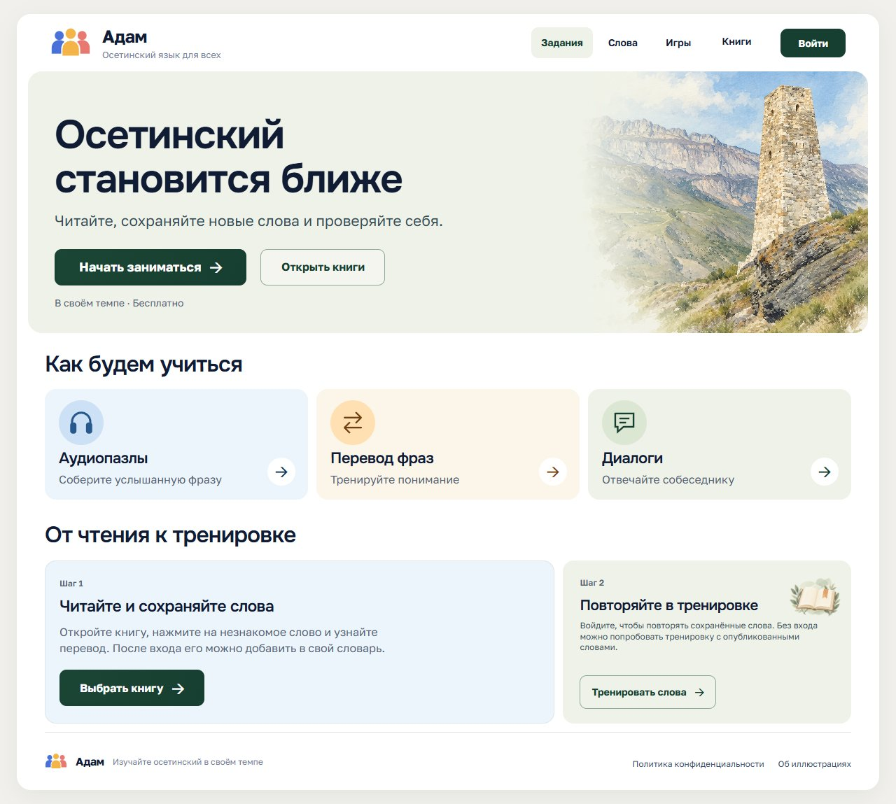
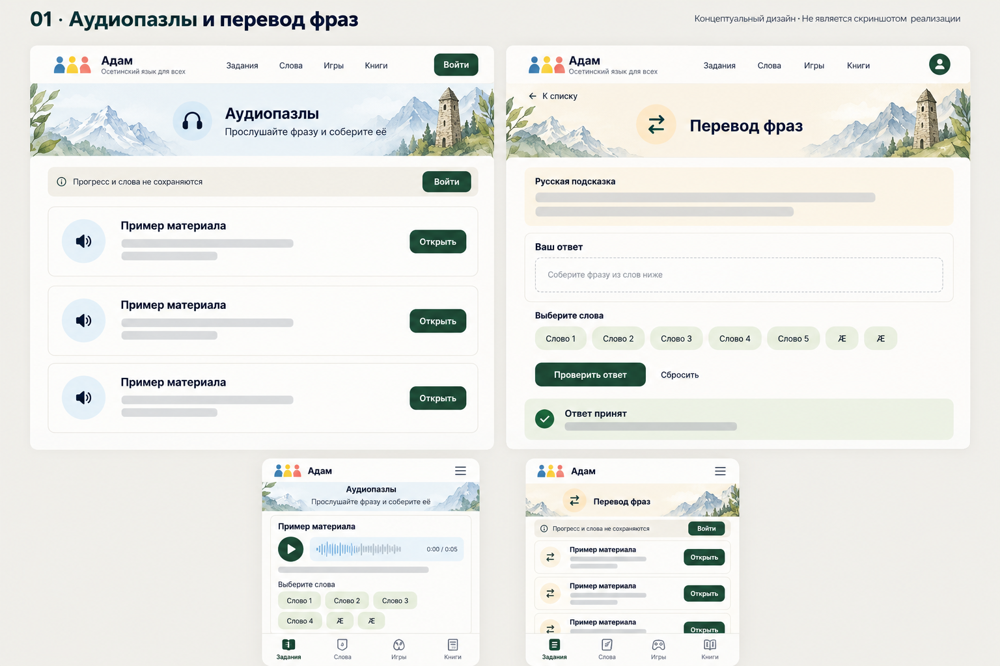
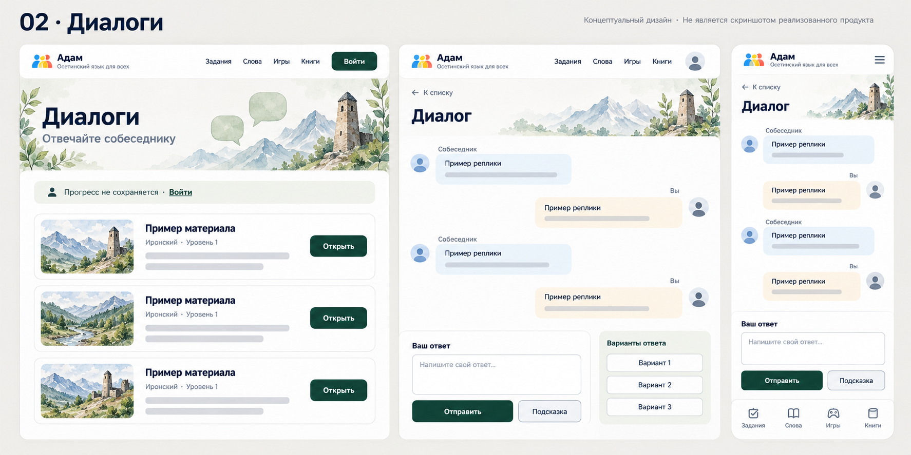
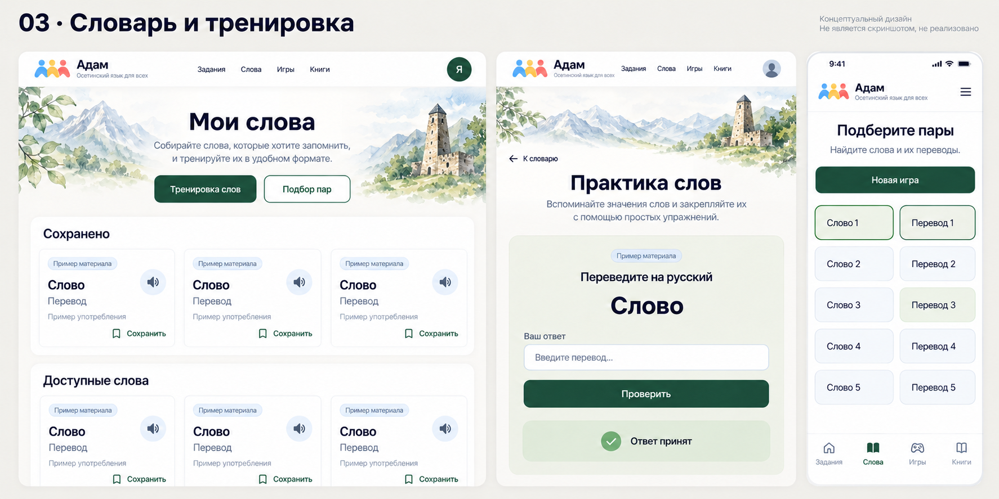
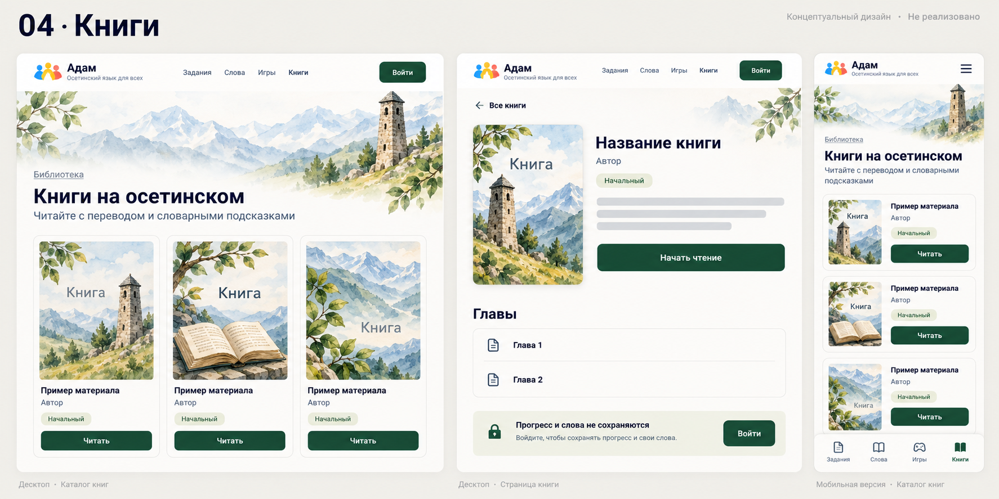
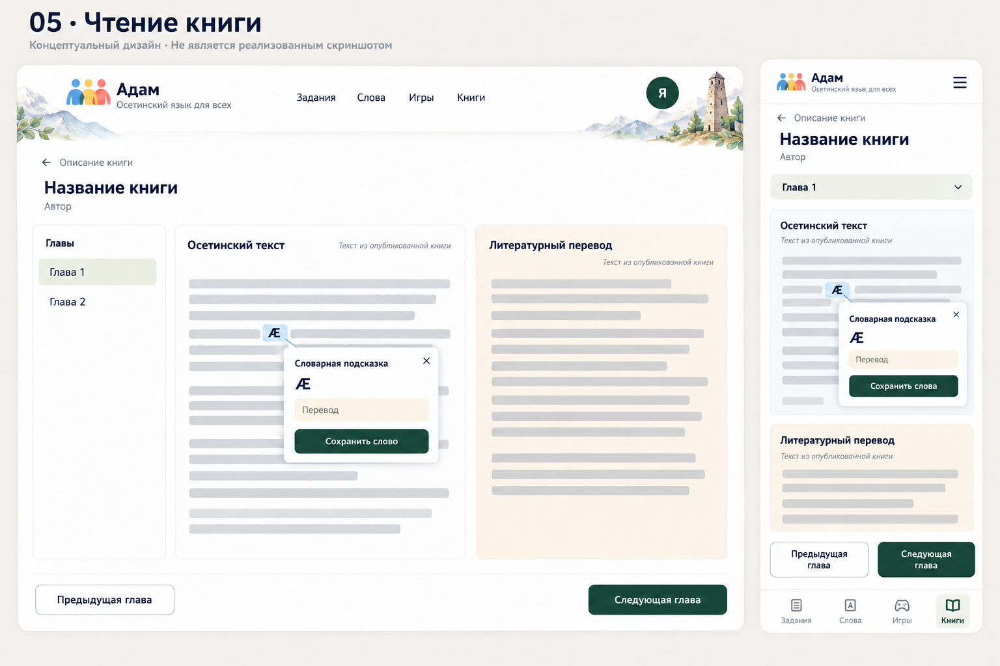
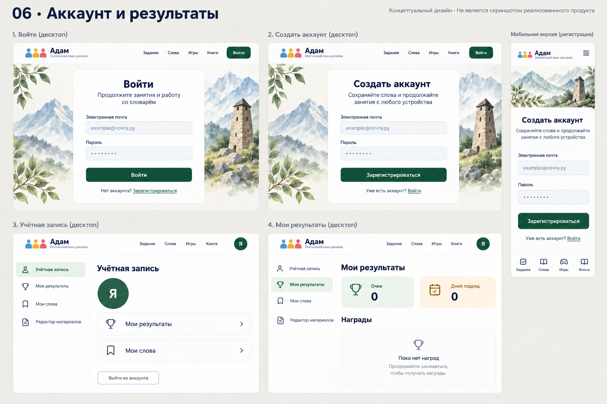
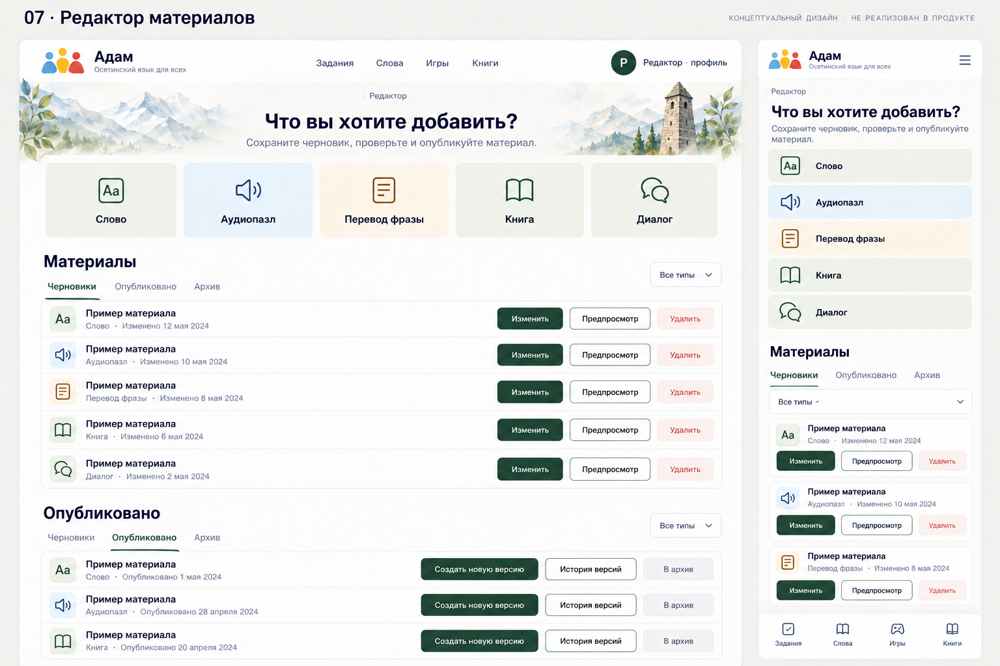
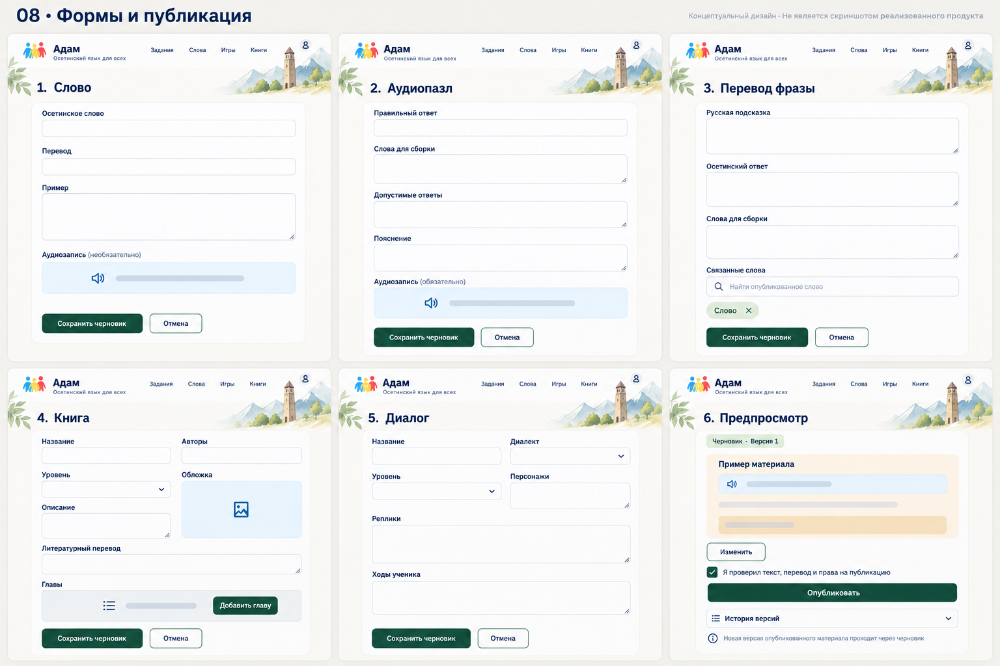
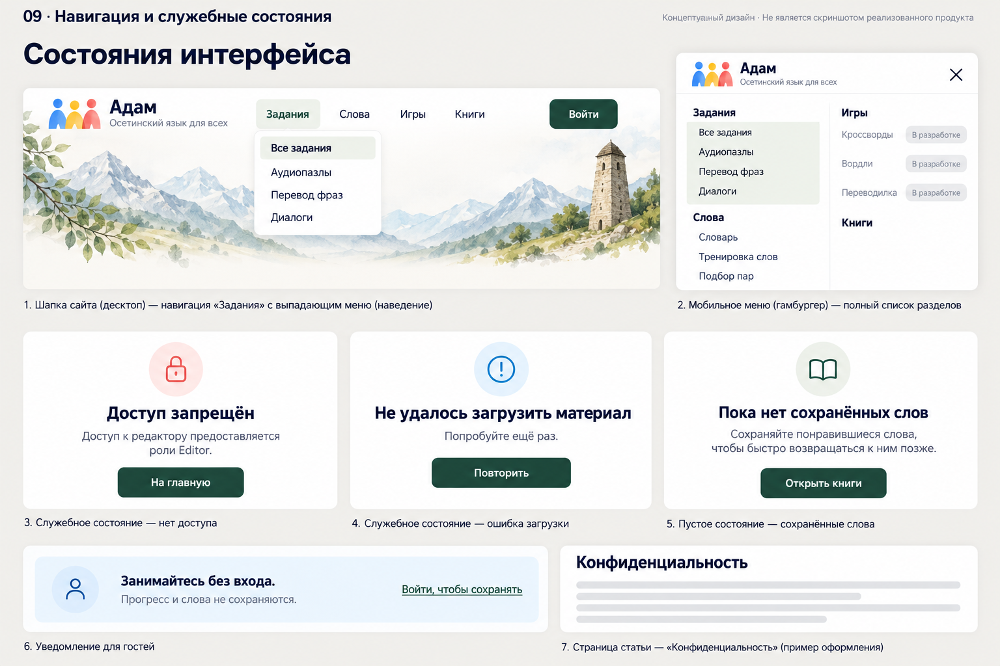

# Дизайн-система «Адам» — зелёная тема

## Новая курсовая система

Доступны каталог `/courses`, личные курсы `/my-courses` и редактор `/author/courses`. Преподаватель создаёт модули и уроки, выбирает собственные и разрешённые упражнения, проверяет предпросмотр и публикует самостоятельно. Редактор сохраняет черновик автоматически и защищает от перезаписи другой вкладкой.

Публикация сохраняет снимки заданий. Ученик автоматически получает актуальную опубликованную программу; прогресс рассчитывается по блокам. Неизменённые блоки сохраняют зачёт. Начатые ответы используют исторический снимок условий, который не переписывается. Гость проходит без записи персонального прогресса в БД. Последовательный режим проверяется сервером. Архив закрывает новые записи, сохраняя доступ уже записанным. Старые курсовые контроллеры отключены; исторические данные не удалены и автоматически не перенесены.

В уроках доступны теория, сборка фразы, аудирование, аудиопазл, соотнесение, «Картинка и слово», форма слова и диалог. В настройках опубликованного упражнения преподаватель отдельно выбирает размещение в общем разделе и разрешение на повторное использование. Новое упражнение по умолчанию доступно только в курсах владельца.

В «Преподавании» доступны связанные уроки, история публикаций и результаты зарегистрированных учеников. Ссылка на исходный урок открывает его черновик в исходном курсе. В админке `/admin/courses` находятся блокировка и история курсов, а в `/admin/course-materials` — владельцы упражнений и список затронутых курсов.

Владелец может удалить курс через «Действия с курсом» → «Удалить курс». Подтверждение удаляет черновик, публикации, записи учеников на курс, попытки и прогресс. Самостоятельные упражнения, версии уроков из личной библиотеки и начисленные баллы сохраняются. Загруженные файлы остаются в хранилище, поскольку их могут использовать сохранённые уроки и другие курсы.

Примените все миграции к подготовленной БД после загрузки `. .\.run-local\connection.ps1`. Новые миграции курсов — `CourseMaterialPermissions` и `CoursePracticeAnalyticsAndAccess`. Они сохраняют старые публикации, попытки и медиа. Для прежних упражнений без подтверждённого владельца прежняя выдача в общем разделе сохраняется, но новое включение в курс требует назначения владельца. Обычный запуск не применяет миграции. Для проверки запустите `dotnet run --project tests/CourseVersionChecks -- --browser` с Edge и Playwright. Проверка создаёт и удаляет собственную временную схему. Без браузера уберите `--browser`, без БД используйте `--rules-only`.
## Админ-панель и Identity

Панель `/admin` работает во всех окружениях и доступна роли Admin. Она включает обзор регистраций и обучения, обезличенные просмотры, пользователей с поиском и страницами, выдачу и отзыв ролей, блокировку, завершение сеансов, сводку материалов и неизменяемый через интерфейс журнал действий. Admin включает права Editor; самостоятельную роль Editor можно сохранить отдельно. Регистрация привилегий не выдаёт.

Перед развёртыванием остановите старую версию приложения, сделайте резервную копию БД и примените миграцию `20261107193635_AdminIdentityAndAnalytics` по [инструкции разработки](docs/DEVELOPMENT.md). ID, пароли, аватары и прогресс сохраняются; прежний `IsEditor` переносится в роль Editor. Все пользователи входят заново. Миграция не выдаёт Admin автоматически и не запускается при обычном старте сайта. Обратная миграция запрещена: для отката нужны согласованные резервная копия БД и прежняя версия приложения.

Первого администратора назначьте существующему аккаунту серверной командой после загрузки подключения:

```powershell
dotnet run --project IronLanguage.Web -- admin-grant --email <email-существующего-пользователя>
```

Команда не создаёт аккаунт и пароль и не применяет миграции; она записывает выдачу роли в журнал. Последующие роли выдаются в панели. Изменение прав и блокировка завершают сеансы; доступ проверяется на следующем запросе. Нельзя заблокировать себя, снять собственный Admin или оставить платформу без действующего администратора. После пяти неверных паролей вход временно ограничивается на пять минут.

Статистика обучения использует сохранённые результаты зарегистрированных пользователей: активность — зачтённый день в UTC, упражнения, диалоги и уроки считаются отдельно по времени завершения. Для посещений хранятся только дневные суммы разделов и событий за 12 месяцев, без IP, User-Agent, полных URL и идентификаторов гостей. Повторные просмотры учитываются; уникальные посетители не определяются. История просмотров начинается с включения сбора. Очередь аналитики ограничена: при сбое БД, переполнении или остановке процесса события могут пропускаться, обучение продолжается.

Гостевые запуски и завершения учитываются для существующих серверных сессий упражнений, диалогов, уроков, соотнесения, картинки и Wordle. Снимки заданий внутри урока учитываются при создании урока. Повторное завершение одной сессии не считается снова. Кроссворды, чтение и практика слов без серверной сессии имеют только просмотры страниц; новые идентификаторы ради аналитики не создаются. Данные содержат технические просмотры и не являются системой определения ботов.

Проверки: загрузить локальное подключение, выполнить `dotnet run --project tests/AdminChecks`; добавить `-- --browser` для Edge/Playwright. Прогон использует только локальный сервер PostgreSQL: создаёт временную схему в настроенной базе, проверяет переход со старой модели, роли, конкуренцию, UTC и агрегаты, затем удаляет собственную схему в `finally`. Браузерный прогон запускает отдельный сайт на порту 58429, создаёт учётные данные только в памяти и сохраняет снимки в игнорируемой `.run-admin`. Нужны права на создание схемы. Основная схема базы не мигрируется тестом.


## Чтение вместо книг

Изображения чтения поставляются в WebP; прежние адреса PNG перенаправляются на те же рисунки без изменения опубликованных книг. Позиция чтения восстанавливается также для пунктуации, пробелов и переносов строк. Браузерные проверки: `npm run test:reading-position` и `npm run test:editor-audio-recorder`.

Проверка выдачи изображений на запущенном сайте: задайте `ADAM_TEST_URL` и выполните `dotnet run --project tests/ReadingChecks -- --http`. Она проверяет GET/HEAD старых адресов, тип и содержимое WebP, не изменяя БД.

Раздел «Чтение» (`/reading`) заменяет прежние «Книги» в меню компьютера, планшета, телефона и на главной. Старый `/books` перенаправляет в новый раздел; API `/api/v1/books` и ID глав сохранены. Каталог открывает произведение сразу: оригинал и проверенный перевод рядом на компьютере, выбор языка на узком экране, изменение размера текста и отдельные иллюстрации между строками. Отступы наследуются от общего `.feature-shell`; футер сохранён. Внешние ссылки на оригинал в читалке не показываются.

Обложки собираются в редакторе из названия, автора, шрифта, цветов и геометрического принта с живым предпросмотром. Есть шесть палитр и девять вариантов принта: без принта, линии, точки, дуги, клетка, волны, ромбы, зигзаг и кольца. Область принта — угол, нижняя половина или вся обложка; полноформатный узор приглушён для читаемости. Контраст текста проверяется при сохранении. У прежних произведений без настроек используется стабильное оформление по названию. Загружать картинку обложки не нужно; изображения внутри текста остаются отдельными иллюстрациями.

Необязательный перевод добавляется к каждой главе; заполнять перевод всех глав не требуется. Обязательное подтверждение проверки текста, перевода и прав перед публикацией разрешает показывать имеющиеся переводы читателям. Отдельной повторной отметки в форме нет. Черновики видит только роль Editor, включая API; строки с ⚠ блокируют публикацию, но не сохранение черновика. Три выбранных перевода («Школьник», «Шалун», «Завещание») опубликованы по указанию пользователя после правок. У рисунка выбираются глава, строка и описание; доступны загрузка PNG/JPEG/WebP до 5 МБ, предпросмотр и удаление из новой версии. Миграция переносит общий перевод одноглавой книги в главу, сохраняя старые поля; общий перевод многоглавой книги остаётся в редакторе для ручного распределения.

Сиды трёх произведений: загрузить локальную настройку БД и выполнить `dotnet run --project IronLanguage.Web -- reading-seed`. Данные — `Data/reading/published-seeds.json`, оригиналы и иллюстрации — из исходной подборки. Команда создаёт отсутствующие произведения со стабильными ID, а старые неизменённые переводы обновляет новой опубликованной ревизией. Пользовательские черновики сохраняются с обновлённой базовой версией. Повторный запуск не перезаписывает редакторские публикации и не отменяет архивирование; несовместимые изменения отменяют транзакцию. Нужен существующий Editor. Сиды применяются явно, при обычном запуске автоматически не выполняются; другие произведения не удаляются и не архивируются.

Однократная замена подготовленной библиотеки: загрузить локальную настройку подключения и выполнить `dotnet run --project IronLanguage.Web -- reading-import --replace-library`. Команда применяет миграции, проверяет наличие восьми внутренних иллюстраций, добавляет восемь оригиналов с черновыми переводами для редактора и переносит прежние опубликованные книги в архив, не удаляя главы и позиции чтения. Повторный запуск с теми же ID не перезаписывает редакторские изменения и ничего не архивирует заново. Не запускать как обычную проверку сборки. Предпросмотр исходных черновиков: `/editor/reading-preview`. [Состояние и источники](IronLanguage.Web/Data/reading/README.md). Проверки: `dotnet run --project tests/ReadingChecks`; с подготовленной импортированной БД — добавить `-- --database`.


## Запись аудио в редакторе

У слова, аудиопазла и аудирования можно записать до двух минут с микрофона, прослушать запись и обрезать её по волновой дорожке с перетаскиваемыми границами. Доступны точные секунды, прослушивание выделения и возврат ко всей записи. Обрезается также загруженный файл или текущая сохранённая запись. Обработка происходит локально в браузере; результат WAV отправляется только при сохранении черновика обычным запросом с CSRF. Запись требует разрешения микрофона и HTTPS (либо localhost); готовый MP3/OGG/WAV до 10 МБ можно загрузить и без микрофона. Проверка с искусственным микрофоном: `node tests/editor-audio-recorder-browser.cjs`.

## Курсы, уроки и теория

`/courses` — компактный каталог опубликованных курсов с поиском, общей сеткой карточек и фильтром «Продолжаю». Курс открывается с раздела «О курсе», содержание доступно по `/courses/{id}/contents`. Урок из содержания открывается сразу. Карточки теории и задания (аудиопазлы, перевод фраз, диалоги и аудирование с вопросом) можно открывать в любом порядке; номера карточек кликабельны. Кнопка «Далее» проверяет завершение задания на сервере. Пропущенные карточки не отмечаются выполненными; урок завершается только после всех карточек. Старые попытки сохраняют прогресс. За теорию и завершение урока дополнительных очков нет; задания используют обычные ограничения начисления.

В шапке для роли `Editor` доступно «Преподавание» (`/editor/curriculum`): вкладки «Мои курсы», «Мои уроки» и «Материалы». В материалах (`/editor`) создание разделено на задания, слова и чтение; библиотека поддерживает поиск, тип, статус и сортировку. Новый урок начинается с выбора первой карточки. В окне добавления разделены теория, поиск готовых заданий и создание новых. При создании задания черновик урока сохраняется, редактор открывается в той же вкладке. После публикации можно вернуться в урок с добавленной карточкой и сохранить черновик. Шаблоны теории: текст, правило, пример с пояснением и сравнение в двух колонках. Карточки можно переставить кнопками или перетаскиванием, последнее удаление можно отменить; справа виден предпросмотр, на телефоне он расположен ниже. Разметка в тексте отображается как обычный текст. Учебный контент не генерируется автоматически.

Раздел автора отделён от обучения: вкладки «Мои курсы» и «Мои уроки» показывают собственные материалы. Редактор курса — одна страница без боковой панели: описание, результаты обучения и аудитория сверху, список уроков ниже. Можно сохранить пустой черновик, выбрать свои уроки или создать новый в отдельной вкладке. Удаление из курса убирает только связь с уроком. Для публикации курса нужны 1–100 различных опубликованных уроков; в черновик можно добавлять неопубликованные. Черновик урока может быть пустым. Для публикации нужна хотя бы одна карточка, всего допускается до 50. Одно задание добавляется в урок один раз. Черновик сохраняется отдельно от публикации; перед публикацией нужно проверить материал и подтвердить права. Одновременные правки из другой вкладки отклоняются с сообщением о конфликте.

Автор может указать для урока практическую цель, время и опубликованные слова для повторения. Уроки группируются по модулям с рекомендованным порядком. Без модулей сохраняется плоский список. Из урока вошедший ученик может сохранить слово в личный словарь. Перед снятием материала с сайта редактор видит опубликованные уроки, где требуется замена.

В «Моих курсах» владельцу доступен отчёт по опубликованному курсу. Он учитывает новые попытки вошедших учеников, начатые из курса. Итоги по уроку считают уникальных учеников, детализация карточек — попытки по каждой версии. Связь с курсом хранится в снимке, поэтому старые и самостоятельные попытки в отчёт не входят. [План пилота](docs/course-pilot.md).

В описании курса, результатах обучения и аудитории доступны заголовки, списки, жирный текст и курсив Markdown. Обложка загружается в формате PNG, JPEG или WebP до 5 МБ и становится видна ученикам после публикации. Кадр 4:5 можно настроить до сохранения черновика.

Имя задаётся при регистрации и меняется в профиле. Публичная страница автора показывает имя, аватар и опубликованные курсы. По имени автора можно открыть страницу со всеми его опубликованными курсами. Вошедший ученик может поставить или изменить оценку от 1 до 5 после завершения как минимум половины уроков курса. Для имени и оценок нужна миграция 20261106232921_CourseRatingsAndPublicName.

При старте урока сохраняются его версия, теория и снимки заданий. Новые публикации их не меняют. Попытки уроков отделены от самостоятельных занятий. Вошедший пользователь продолжает незавершённый урок; курс показывает начатые и пройденные уроки. Мелкая правка сохраняет результаты, существенное обновление помечается в содержании курса. Гостевой урок вместе со всеми попытками хранится единым пакетом до 30 минут бездействия и максимум два часа. По собственной ссылке восстанавливаются шаг и черновик ответа; в БД гостевой прогресс не записывается и после входа не переносится. Если пакет вытеснен или сервер перезапущен, начните урок заново.

Перед запуском примените миграции `20261027105342_CoursesAndLessons` и `20261027192241_LessonAttemptOrigins` к подготовленной базе:

```powershell
. .\.run-local\connection.ps1
.\.tools\dotnet-ef.exe database update --project IronLanguage.Db --startup-project IronLanguage.Web
```

Интеграционные проверки создают временные материалы и публикации. Выполняйте их в отдельной копии подготовленной локальной БД и на отдельном порту, чтобы не менять каталог во время просмотра пользователем. В данном окружении копия настроена в игнорируемом `.run-local/qa-connection.ps1`, проверочный сайт — порт 60658. Для браузерного прогона нужен запущенный сайт с той же базой и стандартным каталогом ключей Data Protection, Node.js, Playwright и Edge. Временная фикстура с cookie хранится только в игнорируемом `.run-local`; завершайте проверку очисткой, в том числе при ошибке:

```powershell
. .\.run-local\qa-connection.ps1
dotnet run --project tests/CurriculumChecks
$env:ADAM_TEST_URL = 'http://127.0.0.1:60658'
node tests/curriculum-browser.cjs
node tests/course-authoring-browser.cjs
node tests/authoring-ux-browser.cjs
dotnet run --project tests/CurriculumChecks -- --cleanup
```

Очистка удаляет только записи и временные медиа данной фикстуры. Команда проверки не запускает импорт словаря или учебных материалов и не применяет миграции автоматически.


## Подбор пар нитками

Обычные слова слева показаны на светло-голубом фоне, справа — на песочном; зелёный фон появляется только после подтверждения пары. Кружочки найденной пары окрашиваются в цвет соединяющей их нитки. До проверки кружочки справа нейтральные и не подсказывают ответ. Это оформление общее для подбора пар и соотнесения.

В `/game` можно протянуть нитку от осетинского слова к русскому переводу мышью или пальцем. Каждая пара имеет свой цвет нитки; в «Соотнесении» (`/matching`) используется та же палитра до десяти цветов. Цвет закреплён за словом слева, не меняется после проверки, при изменении окна или увеличении текста. Верные связи остаются на поле; красный зарезервирован для ошибок. Активная нитка пунктирная, подтверждённая — сплошная. Также доступны два последовательных нажатия, управление Tab и Enter/пробел, отмена выбора через Escape. Проверки: `node tests/game-threads-browser.cjs` и `node tests/matching-threads-browser.cjs` (Edge, без записи в БД).

## Пять букв

Только ошибки появляются компактной янтарной плашкой в центре таблицы, не сдвигая сетку и клавиатуру, и исчезают через 3 секунды. Escape и продолжение ввода скрывают её сразу. При загрузке, проверке допустимого слова и победе предупреждение не всплывает; пока сервер отвечает, повторная отправка заблокирована. Успешное копирование результата подтверждается надписью «Скопировано» на кнопке, без предупреждения поверх поля.

После завершения игры вошедший пользователь может добавить ответ в личный словарь кнопкой «В мой словарь». Если запись ещё не импортирована в БД, сервер добавляет только точное значение из строки и столбца исходного CSV, указанных в каталоге игры, сверяя написание и перевод. Полный импорт словаря не требуется. Повторное добавление не создаёт дубликат.

Каталог `/games` объединяет кроссворды и «Пять букв». Он доступен через меню «Игры» на компьютере и планшете, а также через блок «Игры со словами» на главной. Над заголовком каждой игры расположена обычная текстовая ссылка «← К играм» в общем стиле приложения. Практика слов и подбор пар остаются в разделе «Слова» с возвратом в словарь. В подменю нет дублирующих пунктов «Все задания» и «Все игры»: соответствующий раздел открывается нажатием на его название. На телефоне нижняя панель сохраняет четыре пункта: «Задания», «Слова», «Чтение», «Профиль».

После завершения «Пяти букв» автоматически открывается модальное окно результата: слово, перевод, число попыток, добавление в словарь и копирование. Надпись «Приходите завтра» сопровождается временем следующего слова. Окно не исчезает по таймеру и автоматически показывается при возвращении к завершённой игре; отдельной кнопки «Результат» нет. Закрыть его можно крестиком или Escape. Таблица и клавиатура сохраняют размер и положение. Статистика доступна в окне результата и отдельной кнопкой в заголовке.

В «Игры → Пять букв» (`/games/wordle`) каждый день доступно общее для всех осетинское слово из пяти букв и шесть попыток. Отобраны 300 слов из исходного словаря; допускаются 519 словарных форм для попыток. Ввод — с клавиатуры компьютера, через игровое поле на телефоне или экранные кнопки, включая ӕ. Зелёная буква стоит на своём месте, жёлтая есть в другом месте, серая отсутствует; повторяющиеся буквы учитываются по количеству. Неизвестное слово попытку не расходует.

Возврат к играм доступен на всех размерах экрана. Клавиатура расположена под таблицей внутри общей игровой карточки, без разделительной линии. На компьютере игровая карточка увеличена до 840 px по ширине и 540–780 px по высоте; клавиатура ограничена 500 px. На коротком настольном окне допускается обычная прокрутка страницы вместо уменьшения клеток; верхние отступы от меню и футер сохранены. На телефоне размер клеток подстраивается под окно, клавиатура остаётся над нижней навигацией; модальное окно результата вписывается в экран. Размер таблицы не пересчитывается при вводе или прокрутке; первая буква после перехода по ссылке не расширяет клетки. Гостям показано общее пояснение: прогресс и слова сохраняются после входа. На коротких экранах второстепенный текст скрыт; статистика доступна по кнопке. Экранная клавиатура игры на телефоне заменяет системную. Буквы слегка появляются при вводе, результат раскрывается переворотом клеток, победа отмечается короткой волной. При настройке уменьшения движения эффекты отключены; возвращение к сохранённой игре их не повторяет. При увеличенном тексте содержимое может прокручиваться, чтобы оставаться доступным.

Слово меняется в 00:00 UTC. Победа вошедшего пользователя засчитывает день в общую серию занятий; повторная отправка не даёт повторного зачёта, очки за игру «Пять букв» не начисляются. Попытки сохраняются на сервере и восстанавливаются при возвращении. Гостям доступна серверная проверка в пределах временной гостевой сессии, без записи прогресса в БД. Статистика открывается отдельной кнопкой и включает победы, завершённые игры, распределение попыток и общую серию занятий. «Поделиться» копирует результат с сеткой цветных клеток и прямой ссылкой на игру на текущем домене; ответ в текст не попадает.

Перед запуском примените миграцию `20261016172211_DailyWordle` к подготовленной локальной базе по [инструкции разработки](docs/DEVELOPMENT.md). [Происхождение слов и правила расписания](IronLanguage.Web/Data/wordle/README.md). Проверки: `dotnet run --project tests/WordleChecks` и `node tests/wordle-browser.cjs` и `node tests/wordle-motion-browser.cjs` (живой сайт, `ADAM_TEST_URL`, по умолчанию порт 58328).

[Полный список 300 слов](docs/wordle-words.md). Слова хранятся в JSON внутри проекта и копируются при публикации. На новой БД достаточно применить миграции и настроить подключение; отдельный импорт слов для игры «Пять букв» не нужен. Для переноса личных результатов нужны данные прежней БД.

## Кроссворды

В «Игры → Кроссворды» (`/games/crosswords`) доступны сразу 10 тематических уровней из 4–8 существительных нашего словаря. Русскую подсказку нужно вписать по-осетински прямо в клетки: выберите слово на поле или в списке подсказок и печатайте. Курсор переходит к следующей доступной клетке, проверенные буквы пропускаются. Можно вставить слово целиком с его первой клетки. Кнопка ӕ помогает с вводом; доступны Tab, стрелки, Backspace и Delete, повторное нажатие или Enter на пересечении меняет направление. Для зачёта нажмите «Проверить».

На карточках: 0 звёзд — нет проверенных верных слов, 1 — решено меньше половины, 2 — хотя бы половина, 3 — всё. После проверки верные слова сохраняются в аккаунте и восстанавливаются при возвращении; непроверенные и неверные ответы остаются только до обновления страницы. Гостям доступны все уровни и серверная проверка без записи в БД. Очки и серия занятий за кроссворды не начисляются. Ввод сопровождается лёгким откликом; новые проверенные слова и завершение получают короткую анимацию. При уменьшенном движении эффекты отключены и при повторной проверке или открытии не проигрываются заново.

Перед запуском примените миграцию `20261016135959_CrosswordProgress` к подготовленной базе по [инструкции разработки](docs/DEVELOPMENT.md). Правила версий и источники описаны в [данных кроссвордов](IronLanguage.Web/Data/crosswords/README.md). Проверки: `dotnet run --project tests/CrosswordChecks` (добавьте `-- --database` для подготовленной локальной БД после загрузки `.run-local/connection.ps1`), `node tests/crosswords-browser.cjs` и `node tests/crosswords-motion-browser.cjs` (запущенный сайт, `ADAM_TEST_URL`, по умолчанию порт 58326).

Единый стиль для главной и существующих разделов сайта: спокойная типографика, зелёные действия, светлые карточки и акварельные осетинские горы.

[Технические правила дизайн-системы](DESIGN_SYSTEM.md) · [Галерея макетов](docs/design/mockups-green-v1/index.html) · [Описание экранов](docs/design/mockups-green-v1/README.md)

## Кастомизация аватара

На /profile/avatar можно настроить лицо, волосы, верхнюю одежду, аксессуар и фон персонажа. Брюки и обувь фиксированы. После регистрации настройка предлагается с возможностью пропустить; к ней можно вернуться из профиля. Образ сохраняется в аккаунте и используется в шапке, профиле и упражнениях, где меняются его эмоции.

Перед запуском примените миграцию AvatarCustomization согласно [инструкции разработки](docs/DEVELOPMENT.md). [Описание компонента и проверок](docs/design/avatar-customization/README.md).

## Конструктор диалогов

Персонажи добавляются кнопкой и настраиваются в окне: имя и цвет. Реплики собираются карточками с выбором собеседника; для ученика в том же окне задаются варианты или допустимые ответы, подсказка и пропуск. Реплики можно изменять, удалять и переставлять. Существующие диалоги открываются в этом же конструкторе.

## Конструктор «Соотнесение»

В редакторе создаётся материал вида `matching`: название, пары «Лево | Право» (2–10) карточками, отвлекающие слова (0–5) и необязательные связи с опубликованными словами. Пары и дистракторы валидируются на сервере (NFC, `æ→ӕ`, без латиницы, уникальный левый текст). Ученик проходит на `/matching`: две цветные колонки, соединение ниткой мышью/пальцем или выбор двумя нажатиями, Tab и Enter/пробел, Escape для отмены; верные пары блокируются, неверные помечаются без раскрытия соответствия. Сессия — снимок в гостевом хранилище, без очков и записи в БД.

## Конструктор «Картинка и слово»

В редакторе создаётся материал вида `picture`: название, одна картинка (PNG/JPEG/WebP до 5 МБ в `/media/pictures/`), правильное слово и режим ответа — три варианта (правильный + два отвлекающих, порядок перемешивается) или ввод слова (нормализация как в matching). Ученик проходит на `/picture`: одна картинка, затем выбор из трёх кнопок или поле ввода; результат «верно/неверно» с правильным словом. Сессия — снимок в гостевом хранилище, без очков и записи в БД.

## Конструктор «Форма слова»

В редакторе создаётся материал вида `grammar`: название, предложение с меткой пропуска (ровно одно вхождение, например «___»), правильная форма слова, необязательная подсказка и ровно три отвлекающие формы. Ученик проходит на `/grammar`: предложение с пропуском и четыре варианта формы (порядок перемешивается сервером). Ученика две попытки: после первой ошибки показывается подсказка и можно выбрать ещё раз; после верного ответа или второй ошибки метка пропуска заменяется правильной формой, слова предложения открываются словарную карточку, показываются вердикт, подсказка и связанные слова. Сессия — снимок в гостевом хранилище, без очков и записи в БД.
## Конструктор «Аудирование»

В редакторе создаётся материал вида `listening`: запись (MP3/OGG/WAV до 10 МБ), вопрос, ровно четыре варианта ответа, номер правильного и необязательные текст записи и пояснение. Вопрос и варианты могут быть на русском или осетинском; порядок вариантов сохраняется таким, как его задал редактор, без перемешивания. Ученик проходит на `/listening`: слушает запись, выбирает один из четырёх вариантов и сразу видит результат; правильный вариант подсвечивается, а текст записи и пояснение раскрываются только после ответа. За первое завершение задания в день (UTC) начисляются 10 очков; гость тренируется без записи прогресса в БД. Перед запуском примените миграцию `20261022180325_ListeningExercises` к подготовленной базе согласно [инструкции разработки](docs/DEVELOPMENT.md).

В осетинских полях доступны кнопки `ӕ/Ӕ`, в том числе в окнах конструктора и в ответах диалогов. При сохранении латинские `æ/Æ` приводятся к осетинским `ӕ/Ӕ`.

## Палитра

| Назначение | Цвет |
| --- | --- |
| Фон / белая поверхность | #f1f0ec / #ffffff |
| Основной / вторичный текст | #101b34 / #526273 |
| Кнопки и активные элементы | #173f31 |
| Светлый зелёный | #eff2e8 |
| Аудиопазлы | #ecf4fc |
| Собери фразу | #fcf5e9 |
| Аудирование | #eef7f3 |
| Видимый фокус | #286aab |

## Типографика и компоненты

Заголовки — **Onest**, основной текст — **Golos Text**. Шрифты размещены локально и поддерживают Ӕ/ӕ. Заголовки без засечек; контрастный текст и свободные интервалы сохраняются на узком экране.

Белая оболочка шириной до 1440 px; скругление оболочки 20 px, карточек 16 px, кнопок 10 px. Основные действия зелёные, вторичные — с тонкой обводкой. Иллюстрации плавно сходят к фону и не перекрывают текст.

«Задания», «Слова» и «Чтение» ведут в разделы. На компьютере подменю появляются при наведении и доступны с клавиатуры, без отдельных стрелок. На телефоне (до 600 px) верхняя шапка с логотипом скрыта, чтобы освободить экран; доступна нижняя панель «Задания», «Слова», «Чтение», «Профиль» с зарезервированным местом под ней. На планшете (600–1023 px) верхнее меню содержит группы «Задания», «Слова», «Игры», «Чтение» и отдельный блок аккаунта: профиль, результаты и выход либо вход и регистрацию. Редактор виден только роли Editor. Выделяется текущий пункт внутри группы.

## Мобильные разделы

На экранах уже 600 px задания открываются сразу списком упражнений и двух игр, без большого приветственного блока. В словаре выделены тренировка перевода и подбор пар, сохранённые и доступные слова остаются отдельными списками. Каталог книг представлен мобильной полкой в две колонки: обложка, название, автор и уровень; описание открывается нажатием на карточку. В читалке на телефоне литературный перевод скрыт, оригинал расположен по центру с сохранением авторских отступов; словарные подсказки остаются доступны. В профиле доступны аватар, реальные очки, серия занятий; ссылка редактора видна только роли Editor. Вход и регистрация на телефоне оформлены простой формой без фоновой иллюстрации и вложенной карточки, с удобными полями и видимыми ошибками. Широкие экраны сохраняют прежнюю компоновку.

## Реализованные разделы

Зелёное оформление перенесено на аудиопазлы, «Собери фразу», аудирование, диалоги, словарь, практику слов, подбор пар, библиотеку и чтение, вход, регистрацию, профиль и результаты. Готовый редактор перенесён из `codex/issue-16-design`, аватары — из `feat/17-avatar-customization`. Пошаговые аудиопазлы и команда `exercise-seed` из main сохранены.

Башня Курта и Тага — акварельный акцент главной; Цей — фон библиотеки и входа. В остальных разделах — иконки, цветовые панели и карточки, в читалке — спокойный фон. [Источники, лицензии и промпты иллюстраций](docs/design/green-integration/ARTWORK.md).

Запуск, подключение БД и импорт материалов описаны в [инструкции разработки](docs/DEVELOPMENT.md). Локально перед запуском загрузите `. .\.run-local\connection.ps1`. Импорт не нужен для обычной проверки сайта.

## Главная — текущий интерфейс



## Макеты разделов

Ниже — изображения для обсуждения дальнейшего оформления, а не скриншоты реализованных внутренних страниц. Учебные тексты представлены заполнителями. При переносе сохраняются текущие функции, гостевой режим и права доступа. Использовать оригинальные логотип и иконки из проекта; растровые начертания в макетах приблизительны.

### 1. Аудиопазлы и «Собери фразу»



### 2. Диалоги



### 3. Словарь, тренировка и подбор пар



### 4. Каталог и описание книги



### 5. Чтение и словарная подсказка



### 6. Вход, регистрация, профиль и результаты



### 7. Редактор: библиотека материалов



### 8. Редактор: формы и публикация



### 9. Навигация и служебные состояния




Перед запуском версии с соотнесением примените миграцию `20261016103238_AddMatchingMaterials` к подготовленной базе согласно [инструкции разработки](docs/DEVELOPMENT.md). Без неё список материалов редактора не откроется: отсутствует таблица `Matchings`. Импорт словаря и сидов для этого не нужен.

### Преподавание и повторное использование уроков

Страница `/courses/teaching` доступна преподавателю из подменю «Курсы». В ней находятся авторские курсы, библиотека уроков и ссылка на материалы упражнений. Прежний `/author/courses` также работает.

В меню урока выберите «Сохранить в библиотеку», а в нужном модуле другого курса — «Из библиотеки». Сохраняется отдельный снимок урока; добавление создаёт независимую копию с новыми ID. Изменения копии не обновляют другие курсы. Для новой редакции сохраните урок в библиотеку заново. Библиотека принадлежит преподавателю и не раскрывается ученикам или другим авторам. Опубликованные курсы и начатые попытки по-прежнему используют свои снимки.

Миграция `20261108220012_ReusableLessonLibrary` добавляет отдельную таблицу, не переносит и не удаляет существующие уроки. Автоматическое связанное обновление уроков во всех курсах не реализовано.

### Оформление текста и навигация занятия

В объяснении можно выделить фрагмент и изменить жирность, курсив, подчёркивание, зачёркивание, шрифт, размер, цвет текста и фон. Панель появляется при выделении; Alt+F10 переводит фокус на её инструменты, Escape возвращает в текст. Используется Quill 2.0.3 (BSD), локальные файлы в wwwroot/vendor/quill, без CDN и внешнего сервиса. Версия закреплена в package.json/package-lock.json; файлы quill.js, quill.core.css и LICENSE скопированы из установленного npm-пакета. Оформление сохраняется как ограниченный документ Delta в JSON курса, а не HTML. Сервер допускает только текст и перечисленные атрибуты; произвольные стили, ссылки и вложения запрещены. Старые текстовые блоки продолжают работать. Снимки публикации и библиотеки сохраняют оформление.

Прогресс внутри занятия обозначен квадратами. Завершённый шаг зелёный, текущий обведён. В открытом уроке можно перейти к любому блоку с сохранением попытки. Панель содержания переключает доступные уроки. Последовательность курсов проверяет сервер.

Страница материалов /editor возвращена к оформлению из истории (99993cb): зелёная шапка и цветные карточки. Все девять типов, поиск, фильтры, сортировка и действия над материалами сохранены.
Прогресс блоков курса сохраняется независимо: доступен свободный переход внутри открытого урока, теория отмечается при открытии. Для обновления существующей базы требуется миграция `20261109084953_CourseBlockProgress`; ранее завершённые шаги сохраняются. Доступ к следующим урокам последовательного курса по-прежнему определяется завершением предыдущих.
Авторы курсов могут загрузить обложку PNG/JPEG/WebP до 5 МБ и выбрать палитру страницы в настройках «О курсе». Обложка и тема публикуются вместе с курсом. Файлы находятся в `wwwroot/media/course-covers`; сохраняйте этот каталог при развёртывании и резервном копировании.
В конструкторе курсов доступно аудирование из опубликованной библиотеки: запись, вопрос, выбор одного ответа. При публикации условия фиксируются в версии курса; повтор ответа не меняет результат.

В блок «Объяснение» можно добавить одно фото (JPEG, PNG, WebP до 5 МБ) или видео (MP4, WebM до 80 МБ). Вложение показывается под текстом, а блок может состоять только из медиа. Для фото при публикации обязательно краткое описание. Файлы лежат вне `wwwroot` в `IronLanguage.Web/.course-theory-media` по умолчанию. При развёртывании можно указать отдельный постоянный каталог через `CourseTheoryMedia__Root` и включить его в резервную копию. Прокси должен пропускать запросы размером до 81 МБ. Замена и удаление вложения из черновика сохраняют файлы старых публикаций.

В курсовом занятии неверный ответ не завершает блок. Кнопка «Попробовать снова» создаёт новую попытку, сохраняя историю ошибочного ответа. Статус дальнейшего развития: docs/COURSES_DEVELOPMENT.md.
