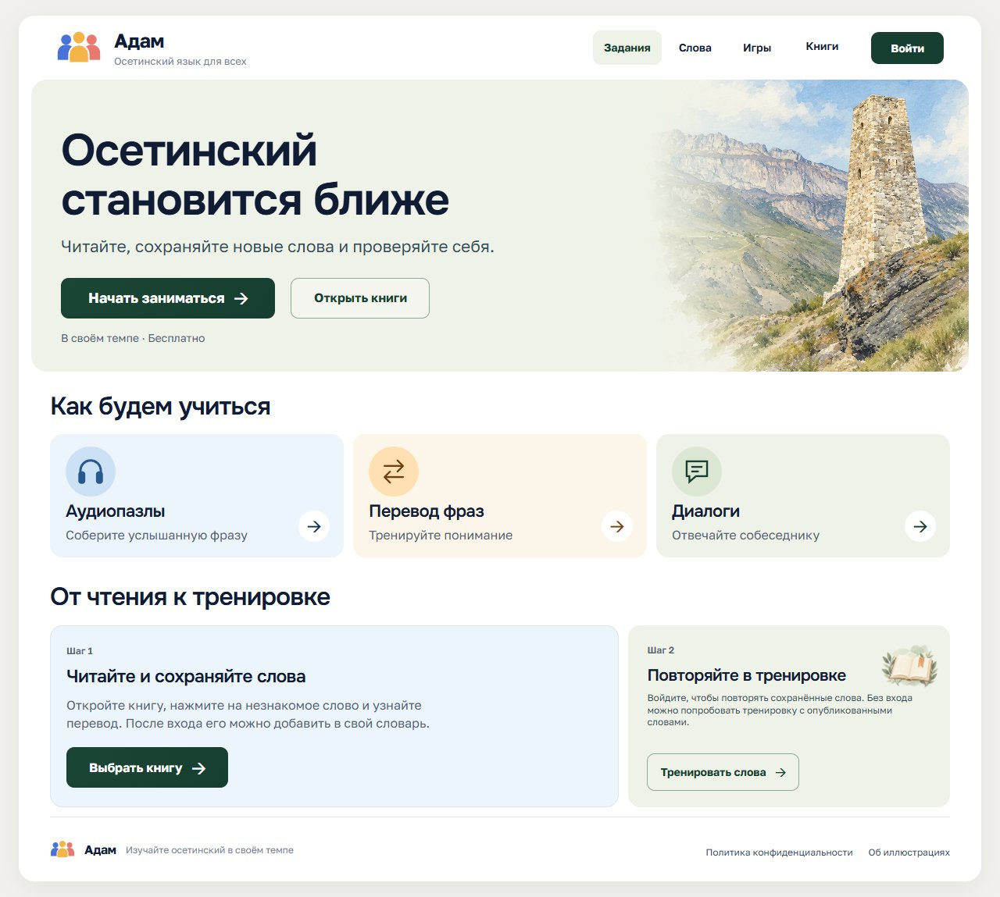
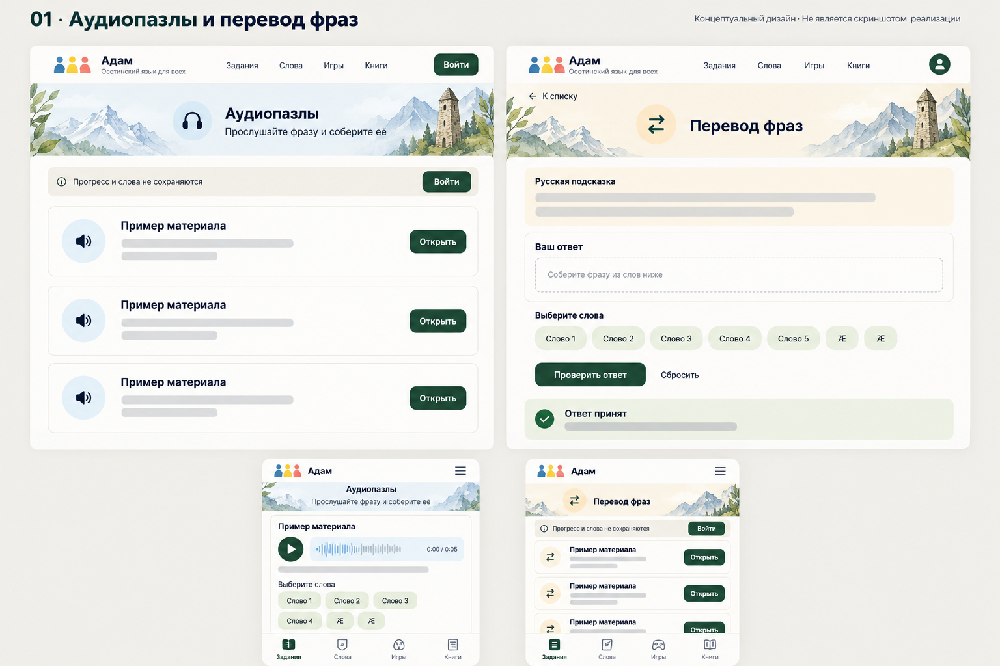
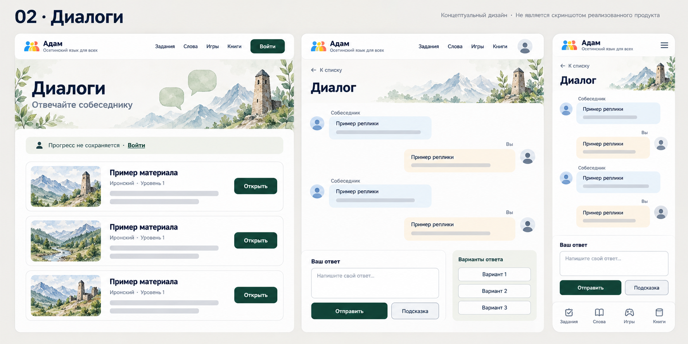
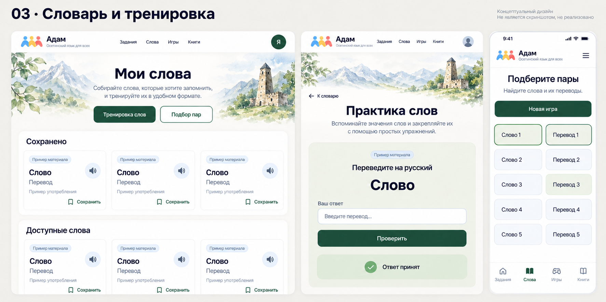
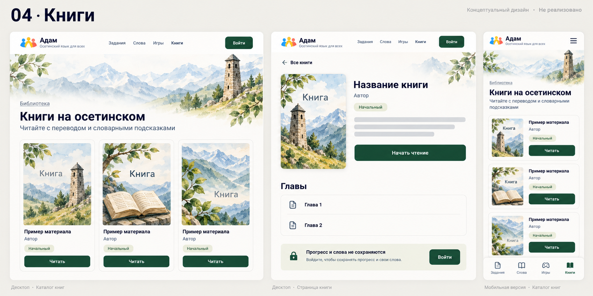
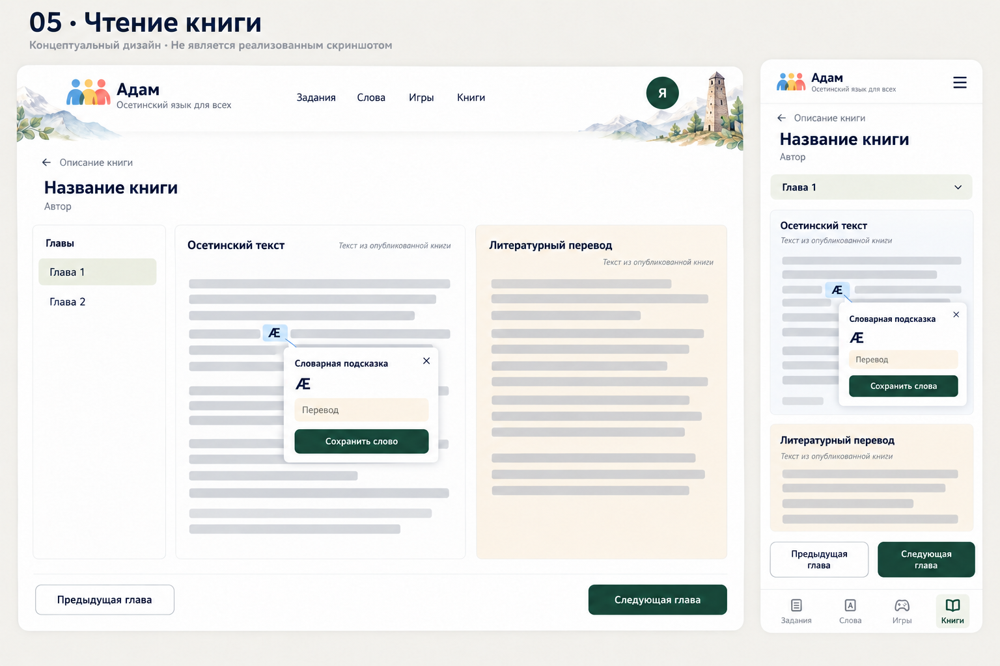
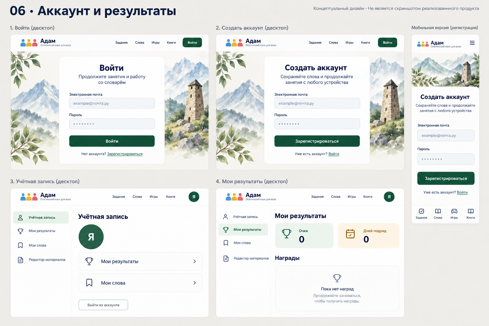
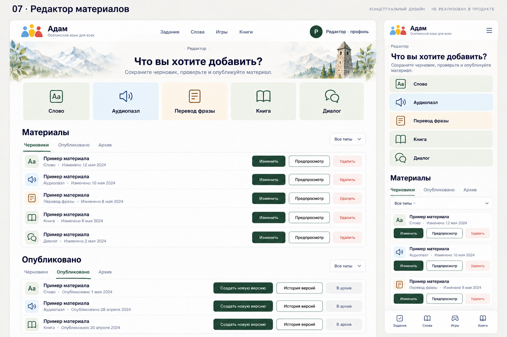
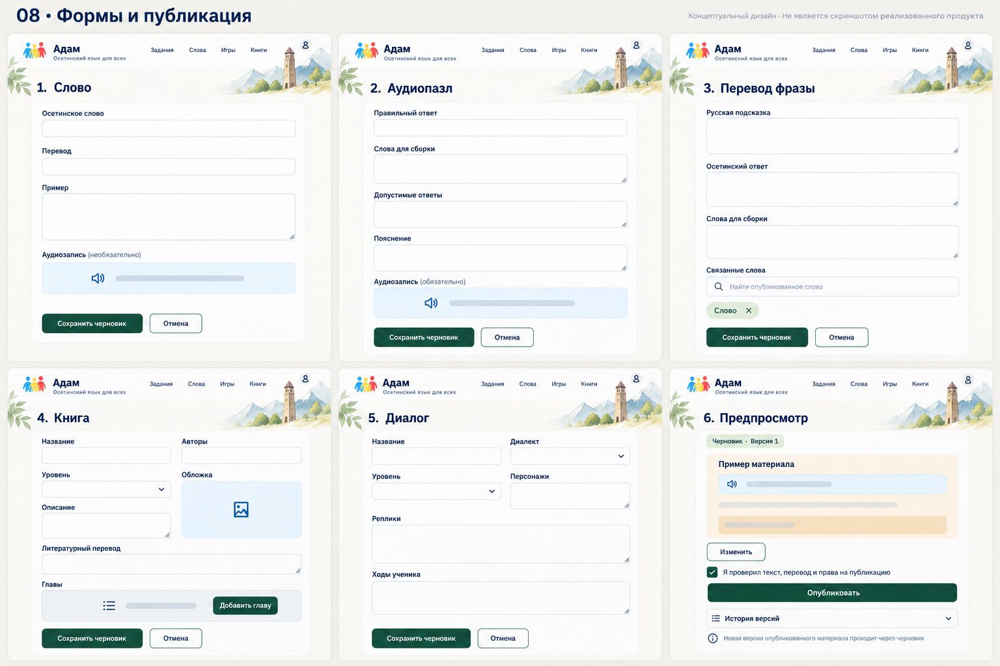
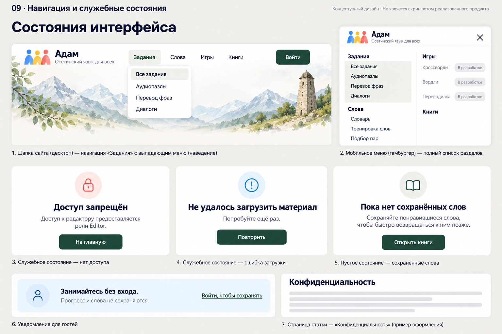

# Дизайн-система «Адам» — зелёная тема

## Подбор пар нитками

В `/game` можно протянуть нитку от осетинского слова к русскому переводу мышью или пальцем. Верные связи остаются на поле, ошибочные кратко подсвечиваются красным. Также доступны два последовательных нажатия, управление Tab и Enter/пробел, отмена выбора через Escape. Проверка: `node tests/game-threads-browser.cjs` (Edge, без записи в БД).

## Пять букв

Только ошибки появляются компактной янтарной плашкой в центре таблицы, не сдвигая сетку и клавиатуру, и исчезают через 3 секунды. Escape и продолжение ввода скрывают её сразу. При загрузке, проверке допустимого слова и победе предупреждение не всплывает; пока сервер отвечает, повторная отправка заблокирована. Успешное копирование результата подтверждается надписью «Скопировано» на кнопке, без предупреждения поверх поля.

После завершения игры вошедший пользователь может добавить ответ в личный словарь кнопкой «В мой словарь». Для сохранения нужен импортированный словарь в БД; сама игра работает и без импорта. Повторное добавление не создаёт дубликат.

Каталог `/games` объединяет кроссворды и «Пять букв». Он доступен через меню «Игры» на компьютере и планшете, а также через блок «Игры со словами» на главной. Над заголовком каждой игры расположена обычная текстовая ссылка «← К играм» в общем стиле приложения. Практика слов и подбор пар остаются в разделе «Слова» с возвратом в словарь. В подменю нет дублирующих пунктов «Все задания» и «Все игры»: соответствующий раздел открывается нажатием на его название. На телефоне нижняя панель сохраняет четыре пункта: «Задания», «Слова», «Книги», «Профиль».

После завершения «Пяти букв» вместо клавиатуры постоянно видна панель результата внутри игровой карточки: слово, перевод, число попыток, добавление в словарь и копирование. Надпись «Приходите завтра» сопровождается временем следующего слова. Панель остаётся при возвращении к игре; отдельной кнопки результата и всплывающего окна нет. Таблица сохраняет размер и положение. Статистика остаётся отдельной кнопкой в заголовке.

В «Игры → Пять букв» (`/games/wordle`) каждый день доступно общее для всех осетинское слово из пяти букв и шесть попыток. Отобраны 300 слов из исходного словаря; допускаются 519 словарных форм для попыток. Ввод — с клавиатуры компьютера, через игровое поле на телефоне или экранные кнопки, включая ӕ. Зелёная буква стоит на своём месте, жёлтая есть в другом месте, серая отсутствует; повторяющиеся буквы учитываются по количеству. Неизвестное слово попытку не расходует.

Возврат к играм доступен на всех размерах экрана. Клавиатура расположена под таблицей внутри общей игровой карточки, без разделительной линии. На компьютере игровая карточка увеличена до 840 px по ширине и 540–780 px по высоте; клавиатура ограничена 500 px. На коротком настольном окне допускается обычная прокрутка страницы вместо уменьшения клеток; верхние отступы от меню и футер сохранены. На телефоне размер клеток подстраивается под окно, клавиатура или итоговая панель остаются над нижней навигацией. Размер таблицы не пересчитывается при вводе или прокрутке; первая буква после перехода по ссылке не расширяет клетки. Гостевое пояснение над игрой убрано; вход доступен через общую навигацию. На коротких экранах второстепенный текст скрыт; статистика доступна по кнопке. Экранная клавиатура игры на телефоне заменяет системную. Буквы слегка появляются при вводе, результат раскрывается переворотом клеток, победа отмечается короткой волной. При настройке уменьшения движения эффекты отключены; возвращение к сохранённой игре их не повторяет. При увеличенном тексте содержимое может прокручиваться, чтобы оставаться доступным.

Слово меняется в 00:00 UTC. Победа вошедшего пользователя засчитывает день в общую серию занятий; повторная отправка не даёт повторного зачёта, очки за игру «Пять букв» не начисляются. Попытки сохраняются на сервере и восстанавливаются при возвращении. Гостям доступна серверная проверка в пределах временной гостевой сессии, без записи прогресса в БД. Статистика открывается отдельной кнопкой и включает победы, завершённые игры, распределение попыток и общую серию занятий. «Поделиться» копирует результат с сеткой цветных клеток и прямой ссылкой на игру на текущем домене; ответ в текст не попадает.

Перед запуском примените миграцию `20261016172211_DailyWordle` к подготовленной локальной базе по [инструкции разработки](docs/DEVELOPMENT.md). [Происхождение слов и правила расписания](IronLanguage.Web/Data/wordle/README.md). Проверки: `dotnet run --project tests/WordleChecks` и `node tests/wordle-browser.cjs` и `node tests/wordle-motion-browser.cjs` (живой сайт, `ADAM_TEST_URL`, по умолчанию порт 58328).

[Полный список 300 слов](docs/wordle-words.md). Слова хранятся в JSON внутри проекта и копируются при публикации. На новой БД достаточно применить миграции и настроить подключение; отдельный импорт слов для игры «Пять букв» не нужен. Для переноса личных результатов нужны данные прежней БД.

## Кроссворды

В «Игры → Кроссворды» (`/games/crosswords`) доступны сразу 10 тематических уровней из 4–8 существительных нашего словаря. Русскую подсказку нужно вписать по-осетински прямо в клетки: выберите слово на поле или в списке подсказок и печатайте. Курсор переходит к следующей доступной клетке, проверенные буквы пропускаются. Можно вставить слово целиком с его первой клетки. Кнопка ӕ помогает с вводом; доступны Tab, стрелки, Backspace и Delete, повторное нажатие или Enter на пересечении меняет направление. Для зачёта нажмите «Проверить».

На карточках: 0 звёзд — нет проверенных верных слов, 1 — решено меньше половины, 2 — хотя бы половина, 3 — всё. После проверки верные слова сохраняются в аккаунте и восстанавливаются при возвращении; непроверенные и неверные ответы остаются только до обновления страницы. Гостям доступны все уровни и серверная проверка без записи в БД. Очки и серия занятий за кроссворды не начисляются. Ввод сопровождается лёгким откликом; новые проверенные слова и завершение получают короткую анимацию. При уменьшенном движении эффекты отключены и при повторной проверке или открытии не проигрываются заново.

Перед запуском примените миграцию `20261016135959_CrosswordProgress` к подготовленной базе по [инструкции разработки](docs/DEVELOPMENT.md). Правила версий и источники описаны в [данных кроссвордов](IronLanguage.Web/Data/crosswords/README.md). Проверки: `dotnet run --project tests/CrosswordChecks` (добавьте `-- --database` для подготовленной локальной БД после загрузки `.run-local/connection.ps1`), `node tests/crosswords-browser.cjs` и `node tests/crosswords-motion-browser.cjs` (запущенный сайт, `ADAM_TEST_URL`, по умолчанию порт 58326).

Единый стиль для главной и существующих разделов сайта: спокойная типографика, зелёные действия, светлые карточки и акварельные осетинские горы.

[Технические правила дизайн-системы](DESIGN_SYSTEM.md) · [Галерея макетов](docs/design/mockups-green-v1/index.html) · [Описание экранов](docs/design/mockups-green-v1/README.md)

## Кастомизация аватара

На /profile/avatar можно настроить лицо, волосы, верхнюю одежду, аксессуар и фон персонажа. Брюки и обувь фиксированы. После регистрации настройка предлагается с возможностью пропустить; к ней можно вернуться из профиля. Образ сохраняется в аккаунте и используется в шапке, профиле и упражнениях, где меняются его эмоции.

Перед запуском примените миграцию AvatarCustomization согласно [инструкции разработки](docs/DEVELOPMENT.md). [Описание компонента и проверок](docs/design/avatar-customization/README.md).

## Конструктор диалогов

Персонажи добавляются кнопкой и настраиваются в окне: имя и цвет. Реплики собираются карточками с выбором собеседника; для ученика в том же окне задаются варианты или допустимые ответы, подсказка и пропуск. Реплики можно изменять, удалять и переставлять. Существующие диалоги открываются в этом же конструкторе.

## Конструктор «Соотнесение»

В редакторе создаётся материал вида `matching`: название, пары «Лево | Право» (2–10) карточками, отвлекающие слова (0–5) и необязательные связи с опубликованными словами. Пары и дистракторы валидируются на сервере (NFC, `æ→ӕ`, без латиницы, уникальный левый текст). Ученик проходит на `/matching`: две цветные колонки, соединение ниткой мышью/пальцем или выбор двумя нажатиями, Tab и Enter/пробел, Escape для отмены; верные пары блокируются, неверные помечаются без раскрытия соответствия. Сессия — снимок в гостевом хранилище, без очков и записи в БД.

В осетинских полях доступны кнопки `ӕ/Ӕ`, в том числе в окнах конструктора и в ответах диалогов. При сохранении латинские `æ/Æ` приводятся к осетинским `ӕ/Ӕ`.

## Палитра

| Назначение | Цвет |
| --- | --- |
| Фон / белая поверхность | #f1f0ec / #ffffff |
| Основной / вторичный текст | #101b34 / #526273 |
| Кнопки и активные элементы | #173f31 |
| Светлый зелёный | #eff2e8 |
| Аудиопазлы | #ecf4fc |
| Перевод фраз | #fcf5e9 |
| Видимый фокус | #286aab |

## Типографика и компоненты

Заголовки — **Onest**, основной текст — **Golos Text**. Шрифты размещены локально и поддерживают Ӕ/ӕ. Заголовки без засечек; контрастный текст и свободные интервалы сохраняются на узком экране.

Белая оболочка шириной до 1440 px; скругление оболочки 20 px, карточек 16 px, кнопок 10 px. Основные действия зелёные, вторичные — с тонкой обводкой. Иллюстрации плавно сходят к фону и не перекрывают текст.

«Задания», «Слова» и «Книги» ведут в разделы. На компьютере подменю появляются при наведении и доступны с клавиатуры, без отдельных стрелок. На телефоне (до 600 px) верхняя шапка с логотипом скрыта, чтобы освободить экран; доступна нижняя панель «Задания», «Слова», «Книги», «Профиль» с зарезервированным местом под ней. На планшете (600–1023 px) верхнее меню содержит группы «Задания», «Слова», «Игры», «Книги» и отдельный блок аккаунта: профиль, результаты и выход либо вход и регистрацию. Редактор виден только роли Editor. Выделяется текущий пункт внутри группы.

## Мобильные разделы

На экранах уже 600 px задания открываются сразу списком упражнений и двух игр, без большого приветственного блока. В словаре выделены тренировка перевода и подбор пар, сохранённые и доступные слова остаются отдельными списками. Каталог книг представлен мобильной полкой в две колонки: обложка, название, автор и уровень; описание открывается нажатием на карточку. В читалке на телефоне литературный перевод скрыт, оригинал расположен по центру с сохранением авторских отступов; словарные подсказки остаются доступны. В профиле доступны аватар, реальные очки, серия занятий; ссылка редактора видна только роли Editor. Вход и регистрация на телефоне оформлены простой формой без фоновой иллюстрации и вложенной карточки, с удобными полями и видимыми ошибками. Широкие экраны сохраняют прежнюю компоновку.

## Реализованные разделы

Зелёное оформление перенесено на аудиопазлы, перевод фраз, диалоги, словарь, практику слов, подбор пар, библиотеку и чтение, вход, регистрацию, профиль и результаты. Готовый редактор перенесён из `codex/issue-16-design`, аватары — из `feat/17-avatar-customization`. Пошаговые аудиопазлы и команда `exercise-seed` из main сохранены.

Башня Курта и Тага — акварельный акцент главной; Цей — фон библиотеки и входа. В остальных разделах — иконки, цветовые панели и карточки, в читалке — спокойный фон. [Источники, лицензии и промпты иллюстраций](docs/design/green-integration/ARTWORK.md).

Запуск, подключение БД и импорт материалов описаны в [инструкции разработки](docs/DEVELOPMENT.md). Локально перед запуском загрузите `. .\.run-local\connection.ps1`. Импорт не нужен для обычной проверки сайта.

## Главная — текущий интерфейс

## Макеты разделов

Ниже — изображения для обсуждения дальнейшего оформления, а не скриншоты реализованных внутренних страниц. Учебные тексты представлены заполнителями. При переносе сохраняются текущие функции, гостевой режим и права доступа. Использовать оригинальные логотип и иконки из проекта; растровые начертания в макетах приблизительны.

### 1. Аудиопазлы и перевод фраз

### 2. Диалоги

### 3. Словарь, тренировка и подбор пар

### 4. Каталог и описание книги

### 5. Чтение и словарная подсказка

### 6. Вход, регистрация, профиль и результаты

### 7. Редактор: библиотека материалов

### 8. Редактор: формы и публикация

### 9. Навигация и служебные состояния

Перед запуском версии с соотнесением примените миграцию `20261016103238_AddMatchingMaterials` к подготовленной базе согласно [инструкции разработки](docs/DEVELOPMENT.md). Без неё список материалов редактора не откроется: отсутствует таблица `Matchings`. Импорт словаря и сидов для этого не нужен.
