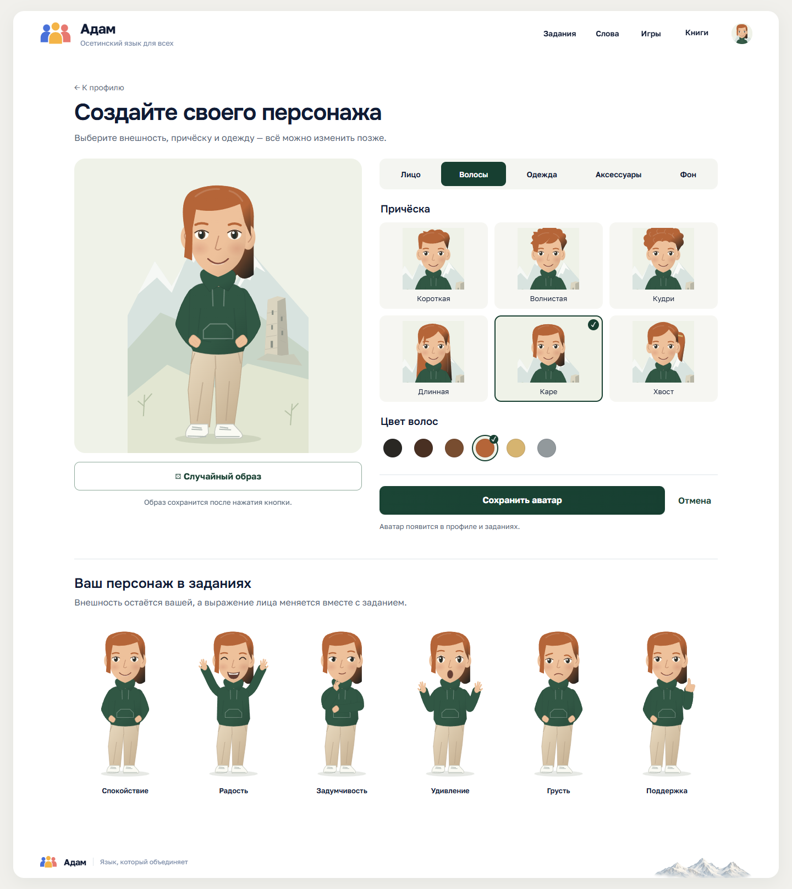

# Конструктор аватаров — ишью №17

Редактор доступен на /profile/avatar после входа. После регистрации открывается тот же редактор с ?onboarding=true: «Пропустить» и «Настроить позже» сразу ведут на главную. Настройка не блокирует создание аккаунта.

Сохраняются форма лица, оттенок кожи, глаза, брови, причёска и цвет волос, верхняя одежда и её цвет, один аксессуар и фон. Персонаж во весь рост; брюки и обувь фиксированы по последнему решению пользователя. Есть случайный образ, предпросмотр, сохранение и отмена. Без JavaScript все категории видны и обычная форма продолжает работать.

Настройки хранятся в nullable-колонке Users.AvatarJson (миграция AvatarCustomization). Для существующих аккаунтов, пропущенной настройки и повреждённой конфигурации используется базовый образ. Обновление проходит через IAccountRepository.SaveAvatar, только для ID из текущего авторизованного пользователя, с CSRF и проверкой каталога вариантов. Произвольные цвета, SVG, пути к изображениям и ID других пользователей не принимаются.

## Отрисовка и эмоции

AvatarRenderer создаёт оригинальный модульный SVG, а не хранит отдельные растровые картинки для каждой комбинации. Иллюстрация следует палитре утверждённого концепта; SVG намеренно проще растрового макета и масштабируется для полного роста и круглого портрета. Фон с башней ориентирован на [фотографию башни Курта и Тага](https://commons.wikimedia.org/wiki/File:Башня_Курта_и_Тага_1.jpg) в Северной Осетии: прямоугольный каменный корпус, небольшие проёмы и верх без остроконечной крыши или замковых зубцов. Фотография в веб-интерфейсе не используется.

Состояния: Neutral, Happy, Thinking, Surprised, Sad, Supportive. Они меняют лицо и позу, сохраняя волосы, кожу и одежду. Эмоция не записывается как настройка внешности. В шапке и профиле используется портрет; аудиопазлы, перевод фраз и тренировка слов используют персонажа во весь рост, задумчивость перед ответом, радость при верном ответе и поддержку при ошибке. У гостей — базовый образ.

Для новой страницы можно подключить _Avatar.cshtml с AvatarDisplayModel, затем вызвать AdamAvatar.setEmotion(containerElement, "Supportive").

Для сервера: AvatarRenderer.Url(options, AvatarEmotion.Happy, portrait: false). URL содержит только проверенные ключи деталей, без идентификатора аккаунта. Публичный /avatars/render проверяет все значения и выдаёт SVG; пользовательские данные он не читает.

## Проверка

Команда node tests/avatar-browser.cjs использует Playwright/Edge и переменную AVATAR_TEST_URL с адресом подготовленного локального сайта. Пароли тестовых аккаунтов создаются только в памяти во время запуска. Проверяются регистрация, пропуск, сохранение, повторное чтение из PostgreSQL, отмена, независимость аккаунтов, CSRF, неизвестные значения, клавиатура, адаптивность, увеличенный текст и переключение эмоций. Скриншоты сохраняются в игнорируемый каталог .run-avatar. Тест создаёт аккаунты в выбранной локальной базе; production-адреса не допускаются.

Для длительного локального просмотра используйте отдельную публикацию через dotnet publish, содержащую wwwroot и сжатые ресурсы, и запускайте DLL из каталога публикации. Сборка через обычный bin или изменяемый obj другого запуска может удалить сжатые файлы, на которые ссылается манифест старого процесса. Проверка браузера дополнительно проверяет непустые CSS и JavaScript при identity, gzip и br. В данном окружении подготовлена публикация .run-avatar/preview и игнорируемый локальный сценарий .run-local/start-avatar-preview.ps1; они используют сохранённую настройку подключения и существующий каталог ключей.

