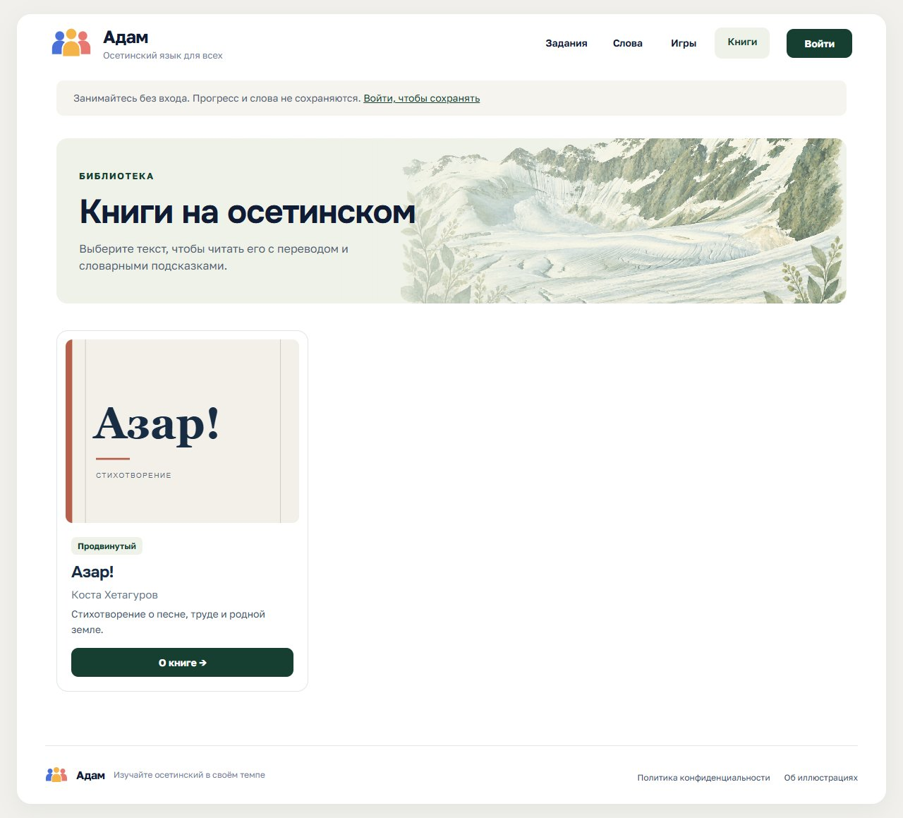
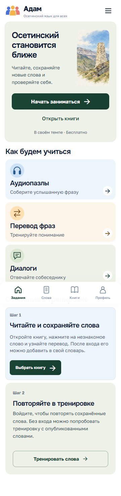
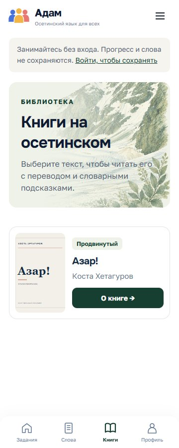

# Зелёное оформление — реализованные страницы

Ветка `codex/green-design-integration`, 15 октября 2026 года. Это снимки работающего сайта, а не концептуальные PNG. Учебные страницы используют материалы подготовленной локальной БД; примеры из старых макетов не добавлялись.

| Главная | Библиотека |
| --- | --- |
|  |  |
|  |  |

[Источники иллюстраций, лицензии и промпты](ARTWORK.md) · [Правила дизайн-системы](../../../DESIGN_SYSTEM.md)

Проверены широкие и узкие окна, клавиатура, текст 200%, чтение с подсказкой, вход и регистрация, аватар, роль редактора, черновик и новая версия аудиопазла, повторный ответ, CSRF и изоляция гостей. Подбор пар проверен только в пустом состоянии: в подготовленной БД одно опубликованное слово. Политика конфиденциальности пока пустая, по указанию пользователя.

Мобильная главная обновлена: иллюстрация отделена от текста. В нижней панели — задания, слова, книги и профиль. Служебные ссылки из меню убраны; подвал на телефонах скрыт. Проверены 360/478/600/700/768/1280 px, разделение областей текста и картинки, переход гостя в профиль и текст 200%.
